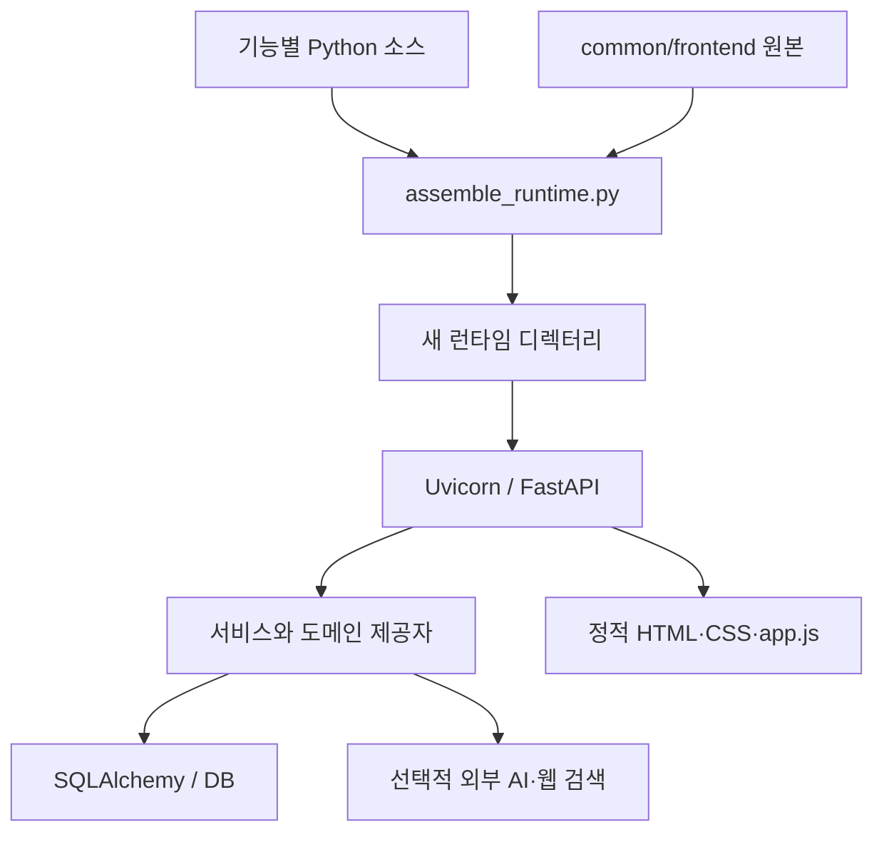

# 실제 실행 경로

기준: `26b8c5296a4008427ffe430122fc3254c9bf4a7b` 및 첫 조립 안전 수정.

| 실제 책임 | 소스 및 확인 근거 |
|---|---|
| Docker 실행 | 루트 Dockerfile이 `/repo/tools/assemble_runtime.py --output /app` 실행 후 `app.main:app` 시작 |
| API 단일 실행 원본 | `tools/assemble_runtime.py`의 APP_FILES가 `system-runtime/backend/main.py`를 선택 |
| Case 쪽 main.py | 위 파일과 blob SHA 동일. 조립 입력에는 포함되지 않는 복본; 제거 필요성/배경은 미확인 |
| 화면 실행 원본 | `common/frontend/app_original.js` → 출력 `frontend/app.js`; index.html/styles.css도 복사 |
| 기능별 JS | README가 검토용 사본이라고 명시. 해당 파일만 고쳐도 실행 화면에 반영되지 않음 |
| 공통 데이터·판단 맥락 | `common/backend/models.py`, `schemas.py`, `services.py` |
| 근거 탐색 | `evidence_discovery.py`: 유료 웹 검색 제공자와 명시적 로컬 데모 제공자를 구분 |
| 신뢰도 | `reliability_engine.py`: metadata-v3 결정론적 평가; 교차 의미 검증은 하지 않음 |
| 출처 점검 | `source_verification.py`: 로컬 URL 구조 검사; 네트워크 요청 없이 PARTIALLY_VERIFIED까지 표시 |
| 판단·권한·실행 | judgment_engine / action_engine으로 분리. 판단 성공이 실행 권한 획득을 뜻하지 않음 |
| 저장 | Compose는 PostgreSQL 볼륨; DATABASE_URL 미설정 직접 실행은 SQLite |

`services.py:97`의 스냅샷은 당시 입력·근거·규칙·모델 옵션을 JSON으로 담는다. `models.py:425`의 History ORM 수정/삭제 방지는 확인했다. 이것이 DB 관리자·직접 SQL에 대한 변조 방지까지 보장하는 것은 아니다.

데이터 마이그레이션 스크립트는 존재하지만 실행하지 않았다. 사용자 DB의 생성/변경/복구 경로는 별도 비파괴 검증이 필요하다.
