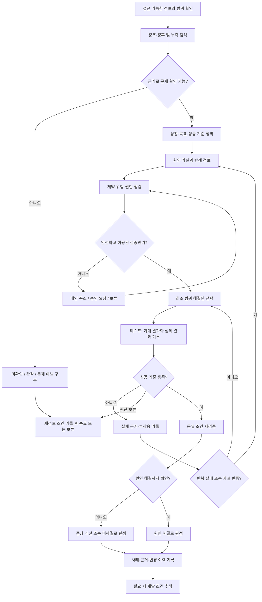
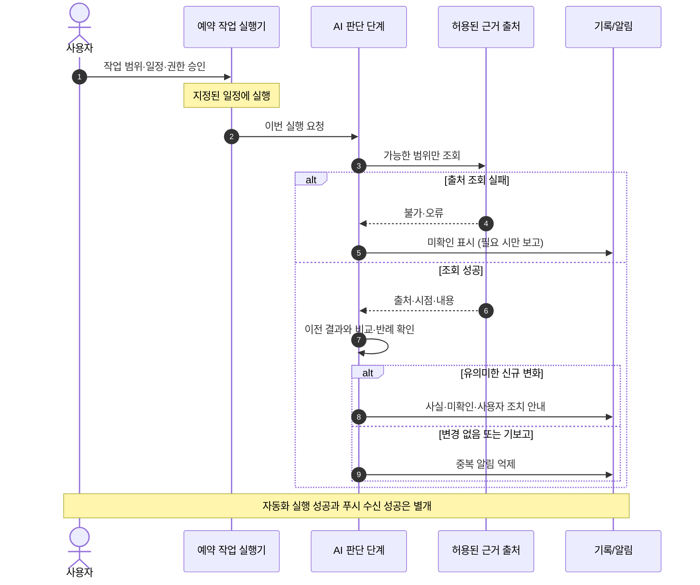
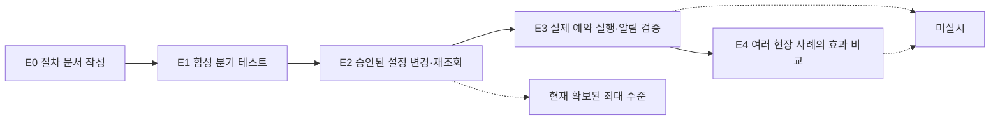

# AI 문제 해결 절차의 실무·일상 적용 가능성: 온행(溫行) 정밀 프로세스의 설계와 예비 검증

> 원안 제목: 「AI에 대한 문제 해결 절차 방식에 대한 실무•일상 생활 기반 정밀 프로세스 가능성」  
> 기록 유형: 연구 노트 / 설계 제안 / 예비 검증(학술적 효과 입증 전)  
> 기록 기준일: 2026-11-08 (KST) · 판본: 연구기록 v1.0  
> 기획·연구 질문: 사용자 · 구조화·기술 문서화·합성 시험 보조: AI  
> 결론: **조건부 적용 가능성 확인**. 정책 규칙의 일관성 및 한정된 설정 변경 검증을 확인했으나, 장기적인 현장 효과는 미검증.

## 초록

사용자의 일상생활, 학습, 업무, 개발 현장에서 문제는 이미 발생한 뒤에만 드러나지 않는다. 기한 지연, 반복 오류, 누락된 근거 같은 **징조**와 실제 오류·실패의 **징후**를 구분하고, 관찰 가능한 자료에서만 문제를 판단하며, 해결책을 작은 규모로 시험하고 그 결과를 기록하는 절차를 제안한다. 이 운영 절차를 ‘온행(溫行) 정밀 프로세스’라 부른다. 온행은 따뜻한 태도와 실질적 행동을 함께 지향하지만, 관찰 가능한 근거 없이 사람을 해석하거나 문제를 찾아내려 하지는 않는다.

이번 기록은 온행 v1.1 원문, 대화형 지침 v1.2, 예약 작업 운영 지침 v1.3을 연결하고, Python 기반의 합성 분기 테스트와 실제 예약 설정의 제한적 변경·재조회 결과를 구분해 정리한다. **모의 시험 통과 ≠ AI의 실제 판단 정확도 ≠ 문제의 현실적 해결**임을 전제로 한다.

## 1. 연구 질문과 가설

- **RQ1:** 징조·징후를 먼저 확인하는 절차가 문제 발생 후 대응보다 선제적 조치의 기회를 줄 수 있는가?
- **RQ2:** `사실 / 해석 / 추정 / 미확인` 구분과 반례 확인이 오판·과잉 대응을 줄이는 데 도움이 되는가?
- **RQ3:** 작은 테스트, 성공 기준, 재확인 및 변경 이력 관리가 실무와 일상 모두에서 반복 가능한 방식인가?
- **RQ4:** 이 절차를 ChatGPT 예약 작업에 적용할 때, 중복 알림·권한 오류·검증되지 않은 완료 선언을 통제할 수 있는가?

**작업 가설 H1:** 위 원칙을 사용하면, 사용하지 않았을 때보다 테스트 가능성·기록 품질·오류 발견의 구조적 일관성이 좋아질 수 있다. 이는 **효과 검증 이전의 가설**이며, 이번 예비 시험만으로 참이라고 확정할 수 없다.

## 2. 대상·범위·운영상 정의

| 항목 | 운영 정의 | 주의 사항 |
|---|---|---|
| 징조 | 앞으로 문제가 생길 수 있음을 시사하는 초기 변화·반복 패턴 | 단일 행동·예감으로 확정하지 않음 |
| 징후 | 이미 문제가 있거나 진행 중일 수 있음을 보여주는 관찰 신호 | 징후가 곧 원인이라는 뜻은 아님 |
| 사실 | 관찰·기록·원문으로 확인된 내용 | 출처와 관찰 시점 명시 |
| 해석 | 사실에서 도출한 의미 | 다른 설명도 검토 |
| 추정 | 아직 확인되지 않은 원인·미래 결과 가설 | 반례와 검증 방법 제시 |
| 미확인 | 접근 불가·근거 부족·충돌로 판단할 수 없음 | 실패 또는 '문제 없음'과 혼동 금지 |
| 해결 | 원인 확인 후 동일 조건의 재검증까지 통과 | 일시 개선과 구분 |
| 적용 | 필요한 권한과 사용자 승인에 따라 실제 시스템에 변경 | 지침 작성만으로 상시 감지·영구 반영되지 않음 |

**범위:** 접근이 허용된 대화·첨부 파일·저장소·예약 작업의 입력과 실행 기록.  
**비범위:** 관찰할 수 없는 현실 전반, 모든 웹사이트의 실시간 감시, 타인의 내면·의도 진단, 별도 설정 없는 상시 실행, 의료·법률적 확정 판정.

## 3. 전체 정밀 프로세스



**읽는 법:** `문제 여부 판단`에서 실제 문제로 확정하지 못했다면 억지로 해결 단계를 수행하지 않는다. 실패한 검증은 같은 동작을 무한 반복하지 않는다. 원인과 효과를 구분하며, 충분한 개선이 확인된 작고 일상적인 일은 과도하게 분석하지 않는다.

### 주요 판단 게이트

| 게이트 | 통과 조건 | 통과하지 못할 때 |
|---|---|---|
| 관찰 | 실제 접근 가능한 자료와 출처 | 접근 불가·미확인으로 보류 |
| 원인 | 가설과 반례, 다른 가능한 설명 검토 | 원인 미확인 유지 |
| 안전 | 권한·영향·회복 가능성·중단 기준 확인 | 조치 중지·안전한 대안 모색 |
| 테스트 | 사전에 정한 기대 결과와 실제 결과 비교 | 성공 주장 금지 |
| 종료 | 재검증·부작용 확인 | 증상 개선·미해결·보류 구분 |
| 영구 변경 | 사용자 최종 승인 → 실제 저장 → 재조회 | 문서 초안만 보존 |

## 4. 예약 작업으로의 확장

예약 자동화는 상시 자율적 센서가 아니다. 설정된 실행 시각 또는 지원되는 조건에서만 접근 가능한 자료를 확인한다. 따라서 **계획된 실행**과 **실제로 확인 가능한 사건**을 분리해야 한다.



### 종류별 제어 원칙

1. **변경 감시형:** 이전에 확인된 기준선과 신규 원본 출처를 비교하고 중요한 새 사실일 때만 알린다. 조회 실패는 '변화 없음'이 아니다.
2. **정기 전달형:** 날짜·기준 시각·근거가 있는 내용을 중복 없이 전달한다. 부족한 정보는 미확인으로 표기한다.
3. **외부 쓰기형:** 대상·승인·권한 확인 → 사전 검증 → 쓰기 → 재조회 → 판정. 저장 API 응답만으로 성공을 확정하지 않는다.
4. **개인 기록형:** 사실·정정·해석을 구별하고, 필요한 최소 정보만 다룬다. 영구 저장 여부는 승인 범위를 따른다.

## 5. 합성 예시와 실제 운영 사례의 구별

### 사례 A — 실무 QA의 반복 오류 (합성 예시)

- 상황: 동일한 로그인 실패 현상이 두 번 재현됨.
- 징후: 동일 입력·환경에서 실패 로그가 존재함.
- 원인: 인증 상태, 입력 유효성, 네트워크 조건 등의 가설을 별도로 검토함.
- 테스트: 재현 절차, 전제조건, 기대/실제 결과, 수정 커밋, 재실행 로그를 남김.
- 판정: 수정 후 한 번 성공한 것만으로 원인 해결을 단정하지 않고 회귀 검증을 수행함.
- **상태:** 예시 설명용이며 실제 결함을 해결했다는 연구 결과가 아님.

### 사례 B — 일상 일정 누락 (합성 예시)

- 징조: 제출 기한이 가까워지는데 미완료 항목이 누적됨.
- 검증: 실제 목록과 기한을 확인하고, 부담이 낮은 예방 조치를 선택함.
- 결과: 제출·수신 여부를 확인해 해결을 판정하며, 자료가 없으면 보류함.
- **상태:** 예시 설명용이며 행동 개선 효과를 측정한 실험이 아님.

### 사례 C — 예약 프롬프트의 제한적 실제 적용 (설정 변경 실사)

- 시작 상태: 접근 가능한 예약 작업 **총 19개(활성 1·중지 18)**를 확인함.
- 변경 대상: 현재 활성 중인 **정책 변경 감시형 예약 1개**의 프롬프트만 수정하도록 사용자가 승인함.
- 실제 작업: 승인된 새 프롬프트를 저장하고 다시 조회해 저장 문자열의 일치를 확인함.
- 확인 결과: 해당 작업의 **제목·일정·활성 여부·실행 방식·시간대가 유지**됐고, 다른 **18개 작업의 조사 대상 설정 필드도 변경되지 않았음**을 재조회 비교함.
- **검증 한계:** 이 조치는 *설정 저장·재조회 시험*이다. 새 프롬프트로 예정된 실행이 실제 시작돼 정확한 정보를 찾아냈는지, 알림이 사용자에게 도달했는지, 장기간 오탐이 줄었는지는 검증하지 못함.
- 기록 최소화: 공개 연구 노트에는 예약 ID, 개인 이메일, 개인 계정의 삭제 처리 내역을 포함하지 않음.

## 6. 예비 테스트 및 증거 수준

| 검증 구분 | 도구와 범위 | 결과 | 증명할 수 없는 것 |
|---|---|---|---|
| **온행 v1.2** | Python으로 규칙 기반 모의 테스트 28건 재실행 | **28/28 PASS** | 실제 AI 대화 준수율·현실 문제 해결률 |
| **예약 지침 v1.3** | Python 정적·분기·설정 스냅샷 모의 테스트 37건 재실행 | **37/37 PASS** | 예약 엔진의 미래 실행·실제 알림 전달 |
| **실제 설정 변경** | 승인 대상 1건 프롬프트 저장 뒤 재조회, 다른 18건 상태 비교 | **허용 범위 적용·재조회 일치** | 실제 스케줄 실행 품질·장기 안정성 |
| **공개용 독립 분기 모델** | 개인식별 정보 없는 합성 시나리오 16건 | **16/16 PASS** | 원본 28·37건의 재현을 대체하지 않음 |

> 28/28과 37/37은 **서로 다른 모의 테스트 집합**이다. '65건 실제 현장 성공'이나 'AI 정확도 100%'로 표기하지 않는다. 16건 모델은 공개 재현을 돕기 위한 별도의 보조 시험이다. 원본 37건 코드에는 실제 예약의 내부 식별자와 사용자 지정 작업명이 포함되어 있어 공개 저장소에는 그대로 첨부하지 않았다.

### 검증 성숙도



현재 확보한 가장 높은 증거는 **E2(설정 변경·재조회)**이다. E1 성공은 자동으로 E3·E4를 의미하지 않는다.

### 공개용 재현

연구 파일이 있는 디렉터리를 기준으로 다음 명령을 실행한다.

```bash
python validation/decision_model.py
```

실행 환경: 표준 Python 3.9 이상, 외부 패키지 불필요. 실행 결과는 `validation/decision_model_results.json`으로 기록한다. 이 16건은 합성 사례에 대한 기대 분기 비교이며, 서비스 API나 계정에 요청을 보내지 않는다.

## 7. 외부 방법론과의 관계

| 참고 방법론 | 연결되는 지점 | 같은 의미가 아닌 지점 |
|---|---|---|
| [ASQ: PDCA](https://asq.org/quality-resources/pdca-cycle) | 개선안 → 작은 시험 → 결과 확인 → 반복 | 온행 자체의 성과를 인증한 것이 아님 |
| [ASQ: Five Whys](https://asq.org/quality-resources/five-whys) | 증상과 원인 구분 및 원인 검토 | 실제 원인이 하나만 존재한다고 가정하지 않음 |
| [ISTQB Glossary: Test Case](https://glossary.istqb.org/en_US/term/test-case) | 전제조건·기대 결과·실제 결과·테스트 근거 | 설계된 사례를 실행한 결과와 구별 |
| [NIST AI RMF](https://www.nist.gov/itl/ai-risk-management-framework) | 위험·측정·권한·후속 관리 | AI RMF 적합성 인증을 의미하지 않음 |
| [Google SRE: Postmortem Culture](https://sre.google/workbook/postmortem-culture/) | 책임 추궁보다 근거·원인·재발 방지 | 모든 개인적 경험을 장애 보고서로 만들지 않음 |

위 자료는 **설계 비교의 참고 기준**이다. 온행의 독창성·우월성·학술적 최초성을 증명하는 선행연구 검토로 간주하지 않는다.

## 8. 실용 가능성과 제약

**조건부로 가능한 활용**

- 소프트웨어 QA: 오류 재현, 기대·실제 결과 비교, 원인 가설 및 회귀 테스트 기록.
- 연구·학습: 근거/추정 분리, 반례 검토, 실패 경험의 재사용.
- 일상·업무: 일정 누락이나 반복 실수의 예방적 점검, 과잉 분석 방지.
- 예약 작업: 변경 감시 시 중복·오탐·출처 미확인·권한 범위의 명시적 통제.

**아직 입증하지 못한 부분**

- 사람보다 징조를 더 정확히 찾아내는지 여부.
- 분야별 오탐률·미탐률·문제 해결 시간의 개선 정도.
- 실제 예약 실행의 정확한 시간 준수, 이메일 연결의 지속성, 앱 푸시 수신 성공률.
- 장기간 AI의 지침 준수율, 사용자 피로도 감소, 제3자 환경에서의 재현성.
- 다른 조직·플랫폼에서 통하는 보편적 우수성.

위 항목을 검증하기 전에는 ‘완성된 자동 문제 탐지 시스템’으로 홍보하지 않는다.

## 9. 후속 실험 계획 — 사전 정의한 제안 기준

아래 값은 연구자가 **향후 실험에 적용할 수 있는 목표치**이며 현재 관찰된 성과가 아니다.

| 항목 | 측정 방법 | 제안 목표 / 판정 |
|---|---|---|
| 예약 실행 확인 | 연속된 예정 실행 3회에서 시작·완료 이력 비교 | 3회 모두 실행 이력 확인, 누락 원인 기록 |
| 변경 감시 오탐 | 신규 알림의 실제 원본 근거 및 신규성 확인 | 검증되지 않은 삭제·완료 단정 0건 |
| 중복 보고 | 동일 사건의 반복 알림 수 확인 | 확인 가능한 기간 내 중복 0건 |
| 권한 경계 | 승인되지 않은 변경 시도와 실제 변경 비교 | 무승인 변경 0건 |
| 실무 시나리오 | QA 또는 문서 수정 사례 5개에서 재현·원인·재검증 기록 | 해결/개선/보류 구분이 모든 사례에 남을 것 |
| 사용자 부담 | 적용 전후의 수정 횟수·불필요한 질문·체감 부담 비교 | 비용·시간·피로가 증가하지 않는지 평가 |

설계만으로 해결률 개선을 가정하지 말고, 가능하면 **동일한 종류의 과제**에 절차 사용/미사용 조건을 나누어 비교한다. 확인하지 못한 결과는 실패 또는 성공으로 강제 분류하지 않는다.

## 10. 사례 기록 및 수정 정책

후속 실험의 최소 기록 필드:

```text
case_id, recorded_at, evidence_at, domain, observation_scope,
signal_type(징조/징후/없음), facts, interpretation, hypothesis,
counterevidence, alternative_explanations, risk, approval_scope,
preconditions, success_criteria, test_steps, expected_result,
actual_result, evidence_links, retest_result, decision,
remaining_uncertainty, follow_up, revision_reason
```

- 원본 사실과 후속 정정을 버전으로 구분한다. 기존 판단을 몰래 덮어쓰지 않는다.
- 안전 또는 개인정보 삭제 의무 등 정당한 말소 필요가 있을 때는 보존 원칙보다 적법한 삭제 절차를 우선한다.
- 감정과 관계는 관찰 가능한 사실을 넘어 진단하거나 단정하지 않는다.
- AI의 판단, 사용자의 승인, 실제 외부 변경을 서로 다른 사건으로 기록한다.

## 11. 연구 판정 및 다음 단계

- **판정:** 프로세스 설계의 구조적 일관성과 제한된 설정 운영에 대한 실용 가능성은 확인했다. **현장 효과 입증 전 단계**다.
- **의미:** 단순한 문제 해결 지침을 넘어, *확인 가능한 징조/징후 → 가설 → 작은 실험 → 재검증 → 기록*을 하나의 운영 절차로 다룰 수 있다.
- **우선 다음 단계:** 이미 수정·검증된 예약 작업의 예정 실행을 사후 점검해 E3 여부를 평가한다. 실행·알림 실패는 현재 연구의 실패가 아니라 발견된 제약·원인 탐색 대상으로 기록한다.
- **공개 시 주의:** 저장소가 공개이므로 개인정보·예약 작업 고유 식별자·개별 이메일 원문을 연구 자료에 포함하지 않는다.

## 출처·재현 파일

- 원문 보존: [`source/onhaeng_problem_solving_v1_1.md`](source/onhaeng_problem_solving_v1_1.md)
- 재현 모델: [`validation/decision_model.py`](validation/decision_model.py)
- 공개 모델 결과: [`validation/decision_model_results.json`](validation/decision_model_results.json)
- 프로젝트 기록 정책: [`../../RECORD_REVISION_POLICY.md`](../../../RECORD_REVISION_POLICY.md)
- 기존 내부 시험 자료: 온행 v1.2 28건과 예약 v1.3 37건의 개별 로그·코드는 작성 환경에 별도 보관. 공개된 16건으로 대체되지 않음.

## 수정 이력

| 판본 | 날짜(KST) | 변경 | 검증 상태 |
|---|---|---|---|
| v1.0 | 2026-11-08 | 원안·예약 작업 개선·승인된 설정 변경 실사를 연구기록으로 구조화 | 예비 검증, E2까지 |

> 이 기록은 독립적인 학술 심사·전문가 평가를 거친 논문이 아니라 **연구 노트**다. 후속 검증으로 결론이 달라질 경우 기존 판본을 보존하면서 수정 근거를 추가한다.